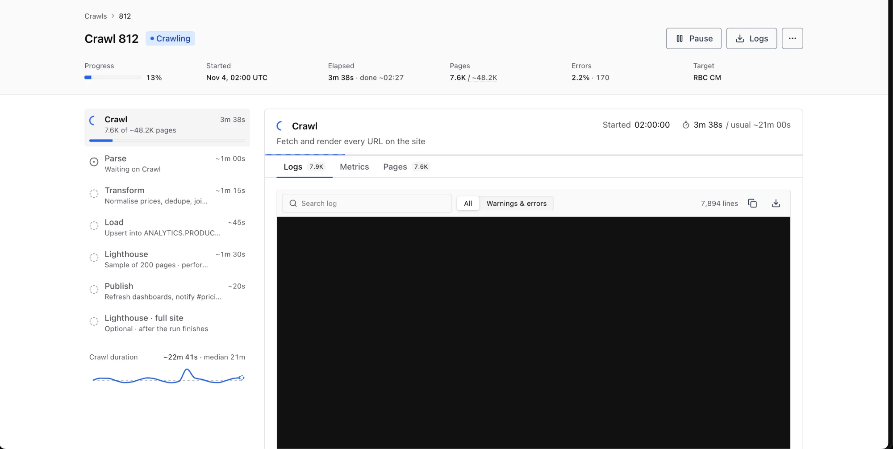

# Plan: what's left to build, in order

Status: updated 2026-11-05

The one plan for moving the prototype into the real app. It lists only what isn't built yet, in order, with a **Done when** list for each part.

Designs it points to:
- [SPEC.md](SPEC.md): the crawl run page (UI, log format, tables, endpoints).
- [docs/pages-and-issues.md](docs/pages-and-issues.md): the read side behind Pages, page detail and Issues (core, storage, element ids).
- [docs/ai.md](docs/ai.md): the three AI systems (navigation, the MCP server, Ask AI).
- Decisions: [docs/adr/](docs/adr/). Terms: [CONTEXT.md](CONTEXT.md).

---

## 1. Where things stand

**Built: Tier 0 (capture) and Tier 1 (the crawl run page)**, inside the existing v2 backend and `intelligence.db` ([ADR 0001](docs/adr/0001-extend-v2-backend.md)):
- **Capture during a crawl:**
  - schema migrations;
  - the crawl dialog's settings reach the crawler;
  - steps with timings, and a run recorder that saves progress samples;
  - the request log in the one format (SPEC §4.3);
  - an outcome row for every URL, including skipped ones;
  - stored stylesheets;
  - element selector and HTML on axe results.
- **The run page on real data, under `/api/v3`:**
  - sites and the crawls list, and starting a crawl;
  - the crawl summary with progress, ETA and history;
  - logs, the Pages tab and metrics samples;
  - pause, resume and settings while paused.

**Open: align the real `/crawls` pages with the prototype** (§2). The real app's crawls list and run page have drifted from what we designed, mostly in the UI. They have to run on real data **and** have exactly the prototype's layout. This comes before Tier 2.

**Next: Tier 2** (§4): Pages, page detail and Issues on real data, then Ask AI on the gateway. **Then Tier 3** (§5): the MCP server and navigation.

The rule that ordered Tiers 0 and 1 still applies to anything new that's captured: **if it isn't recorded during the crawl, it's gone; everything derived from stored data can be built later and re-run** (`POST /crawls/{id}/analyze`).

---

## 2. Alignment: the `/crawls` pages, on real data, laid out exactly like the prototype

**Goal:** `/<site>/crawls` and `/<site>/crawls/<id>` in the real app are the prototype's pages fed with real data. Same layout, same components, same states, same behaviour: 100%, not "close". The only thing that changes is where the data comes from.

**The prototype is the source of truth,** not this document or a screenshot. That means the code in this repo: `src/routes/crawls.tsx`, `src/routes/crawl-run.tsx`, and the components they use (`log-viewer`, `data-toolbar`, `crawl-charts`, `step-ui`, `crawl-settings-dialog`, `app-navbar`, `app-shell`), plus `src/lib/types.ts` and `src/lib/settings.ts`. SPEC.md §3 explains the decisions behind them.

**How to align:**
1. **Use the prototype's files, not rewrites of them.** Where the real app has its own version of a page or component, replace it with the prototype's file. Then change only the data layer: replace the simulator hooks (`useCrawlRun`, `CRAWLS`, `pageAt`) with API queries that return the same types. Keep markup, styles, spacing and copy as they are.
2. **Data that doesn't fit the layout is a data problem, not a layout problem.** If the API returns a different shape, map it to the prototype's types in the query hook. If a value is missing, fix the API, or show the prototype's own empty or "~" state; don't add, drop or rearrange UI to work around it. One known difference: the real pipeline's steps (Discover, Crawl, External links, Checks, Compare, Lighthouse) replace the prototype's Parse, Transform, Load and Publish. The step list layout stays the same, only the rows change.
3. **Compare side by side, state by state.** Run the prototype (`pnpm dev`) and the real app at the same viewport widths (1440 px and 390 px), in light and dark mode. For each state below, put the real page next to the prototype's and fix every difference: layout, spacing, type, colour, icons, copy, empty states, tooltips.
4. **Delete what only the prototype needs:** the grey Prototype bar, the scenario switcher and the simulators.

**States to compare** (the prototype reaches them with its Prototype bar: Healthy run, Rate limited, Fails after crawl; Restart; Skip stage):
- Crawls list: default, searched, filtered by each status, an empty result, the last page.
- Run page: running (Crawl step selected, each tab: Logs, Metrics, Pages), rate-limited (the alert on the crawl step), paused (badge, frozen clock, Settings and Resume), each later step running, succeeded, failed (failed step selected, "Not run · an earlier step failed" below it), and the full-site Lighthouse row before, during and after its run.
- Dialogs: New crawl, settings while paused (Target and Discovery locked), read-only settings from the `⋯` menu.

One state for reference: a running crawl with the Crawl step and its Logs tab selected.

(In this capture the log area is blank. The target shows the log lines, as the prototype does.)

**Done when:**

**Layout**
- [ ] For every state above, the real page and the prototype's are the same at 1440 px and 390 px, in light and dark mode, side by side.
- [ ] The real app's `/crawls` pages use the prototype's route and component files; diffs against this repo touch only data hooks and imports.

**Run page**
- [ ] Each fact appears once on the page. Progress, ETA, Pages, Errors and the rate-limit alert come from real numbers; on a typical crawl the ETA is within ±10% by halfway.
- [ ] A running crawl's step statuses change within ~2 s without a reload. After a failure, the failed step is selected and later steps show "Not run · an earlier step failed".

**Logs**
- [ ] New lines appear within ~1 s and the view follows the bottom; scrolling up pauses it and shows "↓ N new lines". After a network drop, the stream resumes without gaps or duplicates.
- [ ] Every request has one line with its outcome first (`200 GET …`, `301 GET … → …`, `ERR GET … (timed out)`); lifecycle lines are muted. ~50K lines scroll smoothly; "Warnings & errors" narrows to failures. Selection, Copy and Download work, and the download is the whole log.

**Metrics and Pages tabs**
- [ ] Charts update while the Metrics tab is open and stop polling when it closes.
- [ ] Pages filters show correct counts and reset to page 1; search covers all pages. A 3-hop server chain expands; a JS redirect shows Status 200 and a "Client" badge; loops show "Loop" and count as errors; one-hop redirects don't expand. Paging stays stable while rows are added.

**Crawls list, sites and controls**
- [ ] The site switcher lists every site with its logo; switching changes the crawls list and facts, and is remembered after a reload.
- [ ] `/<site>/crawls` shows real crawls with working search, status filters, counts, pagination and CSV; a row opens its run page.
- [ ] New crawl starts from the current site's URL and opens the new run page. Pause stops new requests within ~1 s and the clock stops; Resume continues. While paused, Target and Discovery can't change (UI locked, API `422`); throughput settings can, and the change shows in the log and the rate after resuming.

**Real data** (check with SQL on a small QA-site crawl)
- [ ] Steps have times, samples arrive every ~5 s, every request has a log line, skipped URLs have rows, stylesheets are stored, settings are persisted, and `analyze` still runs.
- [ ] The crawler is no slower with the recorder running.

---

## 3. Vocabulary: backend names vs CONTEXT.md

The two sides use the same words for different things. Don't rename tables now (risky, no payoff mid-integration); **translate at the read-model core**, so the new API and the UI only ever say the CONTEXT.md words. Rename in code opportunistically later.

| CONTEXT.md | Backend today | Watch out |
|---|---|---|
| **Rule** (a named check: axe, Lighthouse or our own) | `Check` / `CheckInfo` / `CHECKS`, axe rules, Lighthouse audits | Backend `rules` means something else (next row). |
| **Custom rule** | `rules` table, `RuleStore`, `RuleMatcher` | Already exists server-side; the frontend keeps them in `localStorage`. |
| **Issue** (one rule failing on one page in one crawl) | `finding_keys` / `FindingsLedger` | |
| **Element** | `finding_occurrences`, `axe_instances` | |
| **Issue status** new / existing / fixed | `FindingsLedger.compare` | Same three values. |
| **Priority** P1–P4, fixed 1:1 from **severity** | `CheckInfo.priority` is set directly; axe has `impact` | Our checks need a severity; derive it from their priority (P1 → critical …). Axe `impact` = severity. |
| **Category** (4 values) | One per check module, more granular (`broken_links`, `i18n`, `indexing` …) | Needs a mapping table in the rule catalog. |
| **Page** (stable across crawls) + **Snapshot** (one crawl's view) | `pages` rows per crawl, keyed by `UrlIdentity.fetch_key` | Stable page ids are new. |
| **Change** new / changed / removed | `page_changes` / `ChangedPageLedger` | "Changed" should hash the main content, not the whole document. |
| **Step** | "stage" (`crawling`, `checking`, `done`) | |
| **Site** (`rbccm`, `rbccm-qa`, …) | `SITE_PROFILES` (rbccm, sterbccm); the crawl stores a URL | Add a site id to `crawls`. |

---

## 4. Tier 2: Pages, Issues, page detail and Ask AI

Sizes: **S** ≤ half a day, **M** ~1 day, **L** 2–3 days.

All of this reads stored data. Build it against the finished crawl and re-run `analyze` until the numbers are right.

| # | Ticket | Size |
|---|---|---|
| **T2.1** | **Rule catalog.** One table of every rule: our checks (`CHECKS`), axe rules, Lighthouse audits, with title, **category** (the 4), **severity**, priority, WCAG criterion, why, how to fix, references. Severity for our checks comes from their current priority. | M |
| **T2.2** | **Stable pages and snapshots.** A `page` table (site + normalised path, stable id across crawls) and `snapshot` (crawl, page, status, title, h1, page type, content hash of the **main content**) built by a new pipeline step from existing `pages` rows and stored HTML. Backfill for old crawls so baselines work. | M |
| **T2.3** | **Elements.** A pipeline step that turns `axe_instances` and check results into `element` rows: `html_hash`, `pattern` (selector with `:nth-*` positions removed), shared-markup counts per crawl, and a **stable element `id`**: a short hash of `(page, rule, selector, html_hash)`, the same in every crawl, so links and the assistant's references survive new crawls ([pages-and-issues.md](docs/pages-and-issues.md) §3 "Ids"). Settle the id before anything links to it. Issue status (new / existing / fixed) by element identity `(page, rule, selector, html_hash)`, consistent with `FindingsLedger.compare` (or replacing it for the new API). | L |
| **T2.4** | **Read-model core** `core/pages.py` and `core/issues.py` (`find_pages`, `get_page`, `find_issues`, `get_issue` by element id, latest crawl by default) and `core/handoff.py` (the prompt text for an issue or a page, shared by Copy as prompt, Ask AI and the MCP prompt), tested through their interface against a seeded database ([pages-and-issues.md](docs/pages-and-issues.md) §3, §5). Plus a site-level `issues_by_rule` for the Issues page and rule detail. | L |
| **T2.5** | **Routes** for Pages, page detail, Issues, rule detail, `GET /api/v3/issues/{id}`; exports (`?format=prompt|json`). Frontend swaps `site-pages.ts`, `page-issues.ts`, `site-issues.ts` for queries, and `resolveIssue` in `refs.ts` for `GET /api/v3/issues/{id}` (chips and fix cards get a loading state); the page detail's `?issue=` takes the element id instead of a position in the list. | L |
| **T2.6** | **Preview endpoint.** Serve a snapshot's rendered HTML with stylesheet links rewritten to `/api/v3/assets/{hash}` (the stylesheets stored during the crawl) and a `<base>` for images; Source view serves the raw HTML. Frontend: remove the Screenshot mode from `page-detail.tsx` / `page-preview.tsx`; the issue-panel crop uses the live render. | M |
| **T2.7** | **Custom rules on the server.** Move them from `localStorage` to the existing `RuleStore`/`RuleMatcher`. Add what the dialog has and the backend may not: scope (content / attributes / source), found vs missing, page type filter, priority, category. Match counts per page from `rule_match_cache`. | M |
| **T2.8** | **Lighthouse scores** `GET …/lighthouse?scope=sample` from `LighthouseStore`, and per-page performance on Pages. | S |
| **T2.9** | **Ask AI on the corporate gateway** ([ai.md](docs/ai.md) §5, §6, [ADR 0003](docs/adr/0003-three-ai-systems.md)). Includes `assistant/gateway.py` with its fake, which navigation reuses. `GET /api/v3/assistant/seed` (visible prompts from `core/handoff.py`), `POST /api/v3/chat` (adds the system prompt, accepts only user and assistant messages, streams server-sent events), `GET /api/v3/assistant/system`. `gateway.py` is the only code that knows the gateway, with `fake_gateway.py` for tests. Frontend: seeds from the seed route; `streamAnswer` in `mock-ai.ts` becomes the chat call; delete the scripted answers. Needs T2.4; answers to the gateway questions in ai.md §6 first. | M |

**Done when** (Tier 2):
- [ ] Comparing two crawls gives the same counts in the tabs and in the API.
- [ ] An element present in the baseline and gone now shows under Fixed.
- [ ] Header and footer elements are marked Shared and point to the template.
- [ ] A link to an element made before a new crawl still opens that element, or shows it as fixed.
- [ ] Every filter and the URL state survive a reload.
- [ ] Ask AI (T2.9): Fix, Explain and Summarize send exactly the prompt the panel shows; answers stream in; chips and fix cards resolve from ids on any page; a gateway error shows as a short message.

---

## 5. Tier 3: the MCP server, navigation and later work

AI systems ([docs/ai.md](docs/ai.md)). Both need T2.4; neither needs the other or T2.9:

| # | Ticket | Size |
|---|---|---|
| **T3.1** | **MCP server** (ai.md §4): read tools for sites, crawls, logs, pages, issues, rules and Lighthouse over the core; the `fix_issue` prompt from `core/handoff.py`; stdio entry and the `/mcp` mount. Write tools only later, behind auth. | M |
| **T3.2** | **URL map** (ai.md §2): `url-map.json` with every route, parameter and allowed value; the pages read their parameters from it; the backend builds `ui_url` from it. Needed by T3.3, and by T3.1's `ui_url`. | S |
| **T3.3** | **Navigation, Cmd/Ctrl+K** (ai.md §3): the palette with instant matches; `POST /api/v3/navigate` via `gateway.complete_json`, validated against the URL map on the server and in the browser; filter chips before going. Reuses T2.9's gateway client, or builds it first if T2.9 isn't done. | M |

**Done when** (AI):
- [ ] MCP: the Inspector lists the tools with typed inputs; `find_issues` accepts a full URL, a path or an id and defaults to the latest crawl; a missing page returns an error naming the latest crawl that has it; in Claude Code, "list the P1 issues on <page> and fix the first one" works end to end.
- [ ] Navigation: the five examples in ai.md §3.1 land on the right URL; an answer with an unknown parameter or value never reaches the address bar; with the gateway down, instant matches still work.

Other later work:
- **Full-site Lighthouse job** and **retry from step** (SPEC §6.5). Done when: Run starts the full audit as its own row with live progress, logs and scores, and the crawl stays "Succeeded"; a second request while one runs is refused (`409`); retrying a failed step starts from that step, keeps the crawl output, and the log shows "attempt 2".
- **Concurrent crawling:** a worker pool sized by `settings.concurrency`, with per-host pacing and the rate-limit guard working across workers; then unlock the field in the dialog.
- **Retention:** delete logs, samples and per-URL rows of crawls older than 30–90 days.
- **Retire** v1 (`main.py` routes, `crawler.py`, `db.py`, `LegacyArchive`), the WebSocket fan-out, and `overview.py`/`OverviewFacts` once nothing reads them. `ManualWcagStore` has no screen in the new UI yet: keep its tables, drop its routes later if nothing needs them.
- **Rename** internals toward the glossary (`checks` → rules, `findings` → issues) when touching those files anyway.

---

## 6. Decisions (agreed 2026-11-05)

1. **No screenshots; Live render is the only preview mode** ([ADR 0002](docs/adr/0002-live-render-only-preview.md)). The crawler captures no screenshots or element boxes. The page preview renders the stored HTML with the stored stylesheets, and the crop in the issue panel comes from the live render too. The frontend drops the Screenshot / Live render toggle.
2. **Concurrency is locked for now.** The dialog shows the engine's current value read-only, and the API rejects any other value with a `422`. A real worker pool is in Tier 3.
3. **The old `intelligence.db` is kept and migrated in place.** Its crawls are the baselines for new/fixed and the history for ETAs.
4. **Three AI systems, each limited to one kind of output** ([ADR 0003](docs/adr/0003-three-ai-systems.md)).
